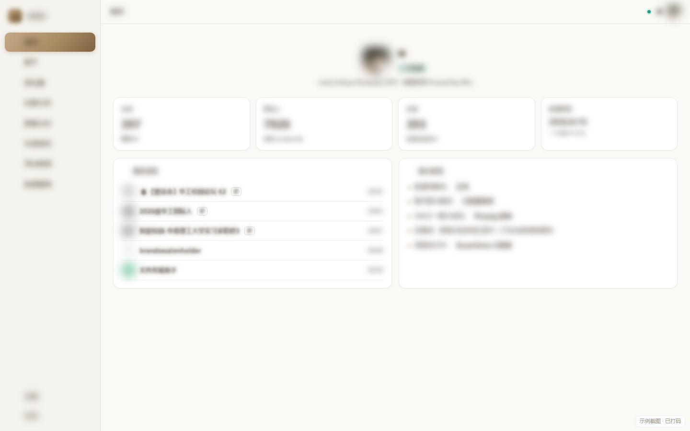
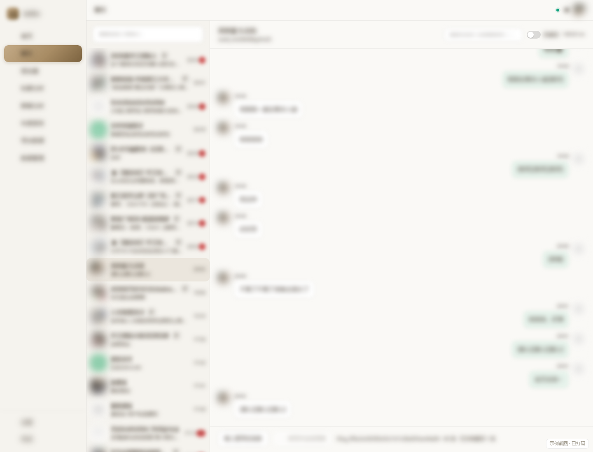
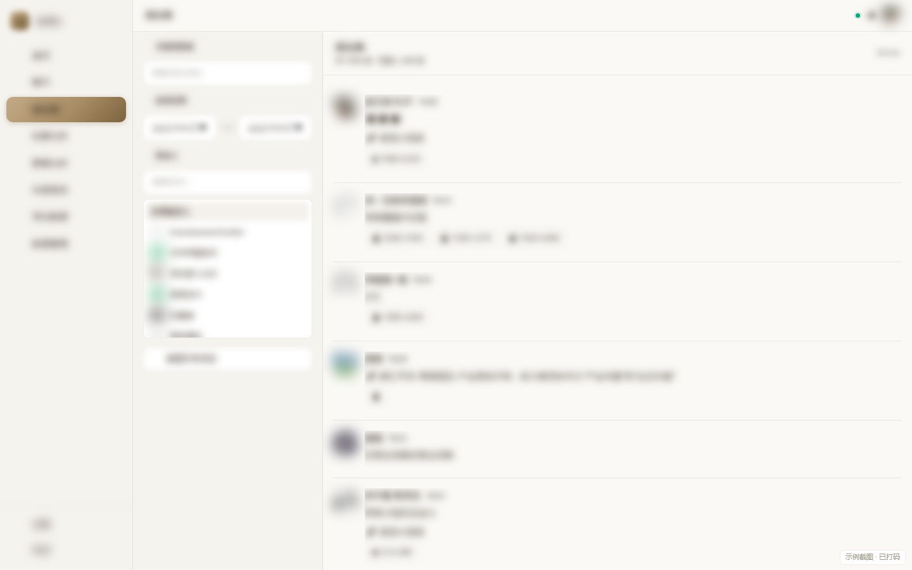
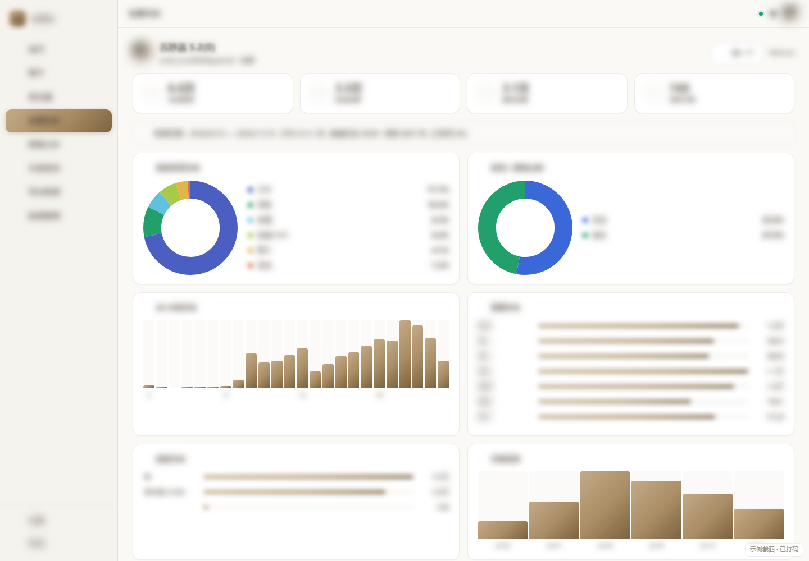
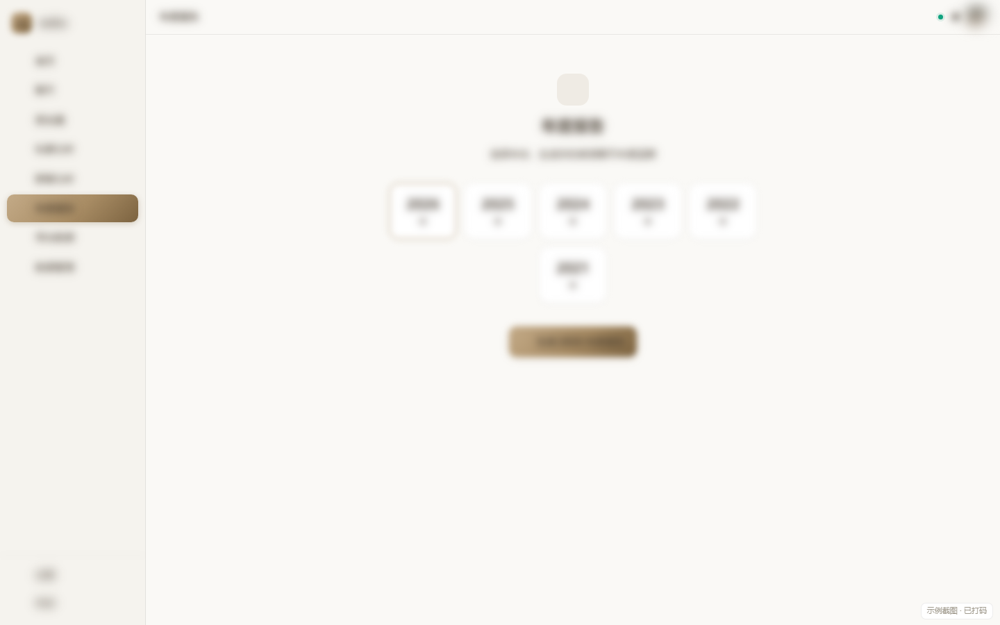
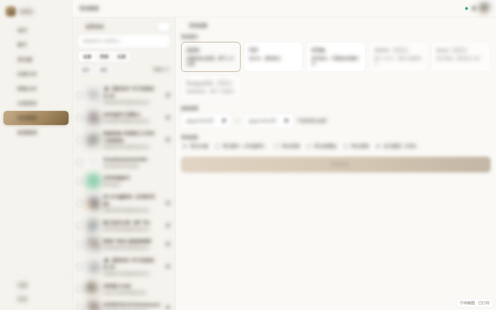
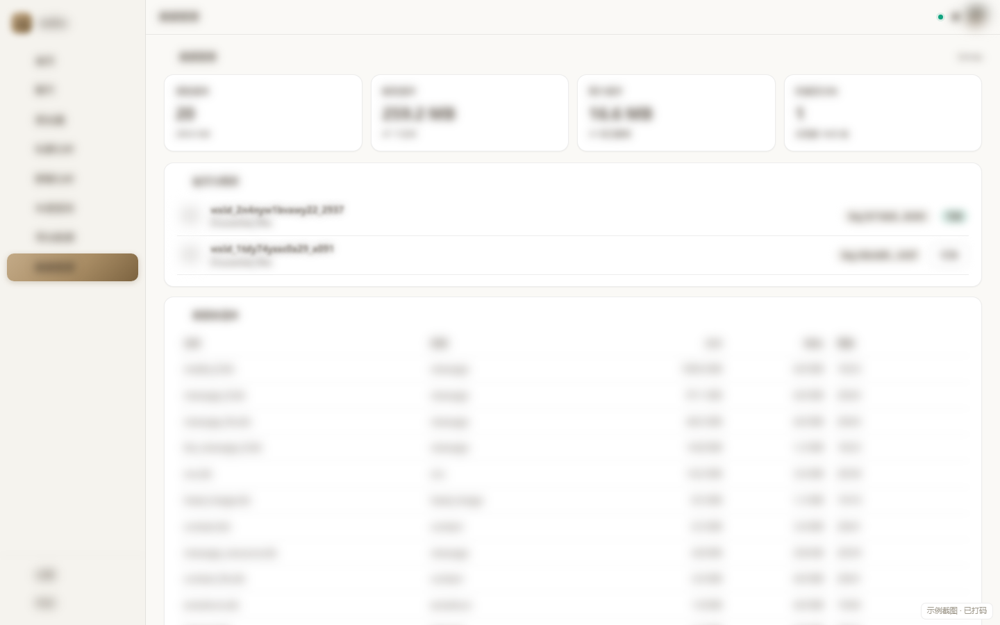
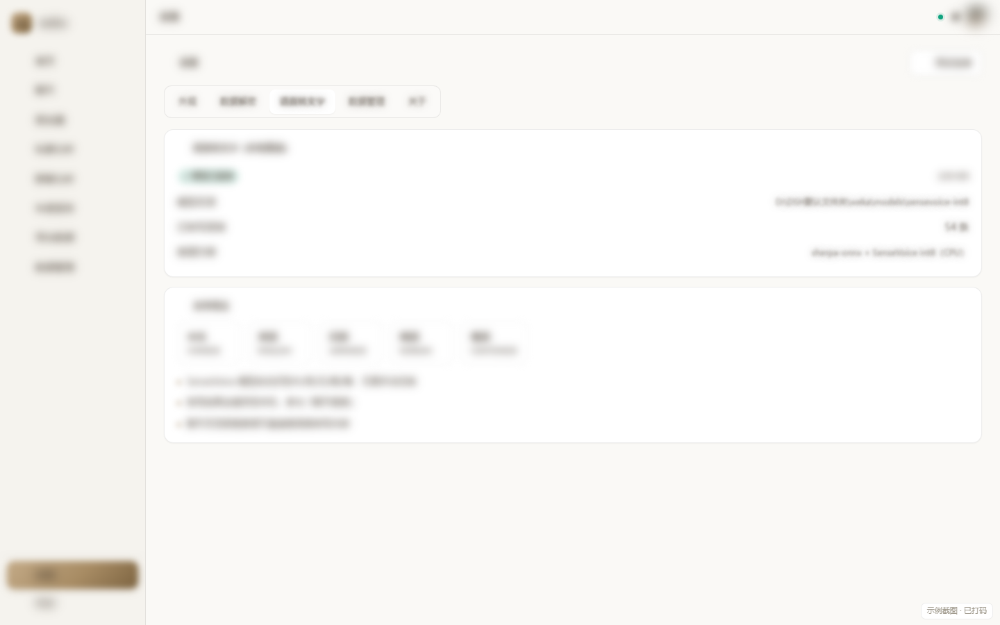

# weka

微信 4.0 桌面版聊天记录的**本地浏览器 + 分析工具**。零外界依赖，纯 Node 实现，自带 SQLCipher 解密引擎，界面按 WeFlow / CipherTalk 的设计语言重做。

> 背景：WeFlow 的原生数据组件（`wcdb_api.dll`）内置"运行时策略"授权校验，到期后整体拒绝运行并返回 `-101`，且上游已停止分发（releases 清空、`api.weflow.top` 下线）。weka 不复用那套组件，从解密到查询全部自己实现。

## 界面

> 下面所有截图都由 weka 内置的**打码模式**生成：文字统一模糊、头像与图片模糊，只保留布局、配色和图表形状。
> 你自己使用时关掉打码（设置 → 外观 → 截图打码模式）就是正常界面。

| 首页 | 聊天（图片解密 + 语音转写） |
| --- | --- |
|  |  |

| 朋友圈 | 私聊分析 |
| --- | --- |
|  |  |

| 年度报告 | 导出数据 |
| --- | --- |
|  |  |

| 数据管理 | 设置（语音转文字） |
| --- | --- |
|  |  |

九个页面（设计参照 WeFlow / CipherTalk）：

| 页面 | 说明 |
| --- | --- |
| 首页 | 账号连接状态、会话/联系人/未读/数据跨度概览、最近活跃、能力状态 |
| 聊天 | **左右独立滚动**；真头像；**图片从本地 DAT 缓存解密显示**（点击放大）；**语音一键转文字**（本地离线）；**防撤回开关**；**会话内搜索（含语音转写）** |
| 朋友圈 | 左侧筛选栏（关键词 / 时间范围 / 联系人）+ 右侧时间线 |
| 私聊分析 | 4 张统计卡（总数/发送/接收/活跃天数）+ 数据范围条 + **消息类型分布环形图** + **发送接收比例环形图** + 时段/星期/月度 |
| 群聊分析 | 同上 + 群成员发言排行 |
| 年度报告 | **年份卡片选择 → 生成报告**；逐月柱状图、时段热度、三张排行榜 |
| 导出数据 | **双栏**：左侧会话多选（全部/群聊/私聊 + 全选/清空）、右侧格式卡片（JSON/TXT/HTML，JSONL/Excel/PostgreSQL 标注即将支持）+ 时间范围 + 导出选项 |
| 数据管理 | 源库清单、解密缓存、图片缓存、防撤回归档、账号与脱敏密钥、账号切换 |
| 设置 | 标签页：外观 / 数据解密 / 语音转文字 / 数据管理 / 关于；**截图打码模式** |

## 重点能力

### 聊天图片（本地缓存解密）
`hardlink.db` 的 `image_hardlink_info_v4` 建立 md5 → 文件名索引，`dir2id` 把 `dir1/dir2` 还原成真实目录：
`msg/attach/<会话md5>/<年-月>/Img/<file>.dat` → 15 字节头 + AES-128-ECB 段 + XOR 段解密。
约 87% 直接解出 JPG/PNG；剩余为 WXGF(HEVC) 容器，自动调 ffmpeg 转码（找不到 ffmpeg 时降级为「图片未缓存在本地」提示）。
实测本机 10/10 图片解密成功。

### 防撤回（旁路归档，不改微信数据库）
微信撤回 = 删行。weka 每次读取会话时把当前消息快照写入自己的 `~/.weka/archive.db`，
下次读取时若某条消息在当前窗口内"消失"，即判定为撤回并保留原文，可在聊天页开关里回显（带「已撤回」标签）。
同时兼容读取 WeFlow 遗留的 `_weflow_anti_revoke_deleted_cache` 表。
> 说明：只能记录**从现在开始**发生的撤回（历史撤回早就不在库里了）。

### 语音转文字（本地离线，已可用）
微信 4.0 的语音不在文件系统里，而是**直接存在 `media_0.db` 的 `VoiceInfo.voice_data`**（带 `0x02` 前缀的 SILK）。

```
VoiceInfo.voice_data (SILK)
  → silk-wasm 解码 → PCM 16bit / 16kHz
  → sherpa-onnx + SenseVoice int8 → 文本
  → 缓存进 ~/.weka/archive.db 的 transcripts 表 → 参与搜索
```

- 定位：优先 `svr_id` 精确匹配，其次 `(chat_name_id, local_id)`，最后 `create_time` 兜底
- 实测速度：模型首载约 1s（之后常驻），4~8 秒语音约 **70~140 ms**；批量 10 条约 1.4 秒
- 语音支持中/英/日/韩/粤自动识别
- 聊天页语音气泡点一下即转写；页脚「转写本会话语音」可批量；顶部搜索框能搜到转写内容
- 三条路径都能触发：界面点击、界面批量、命令行 `weka transcribe <会话>`

模型与运行时依赖**不外装**，全部在项目内：`models/sensevoice-int8/`（见 `models/README.md`）、`vendor/`（见 `vendor/VENDOR.md`）。
## 双击启动（推荐）

项目根目录和桌面都放好了启动入口，**双击即可**：

| 文件 | 作用 |
| --- | --- |
| `启动 weka.bat` | 启动本地服务并自动打开浏览器（已运行时只开浏览器，不会重复启动） |
| `停止 weka.bat` | 停止占用 7080 端口的服务 |
| `launcher.vbs` | 供上面脚本调用的隐藏启动器（不弹黑框） |
| 桌面 `weka.lnk` | 指向 `启动 weka.bat` 的快捷方式，带 weka 图标 |

双击后：服务在后台隐藏运行 → 就绪后自动打开 `http://127.0.0.1:7080` → 启动窗口关闭。
服务日志在 `logs\server.out.log` / `logs\server.err.log`。

命令行参数（需要时用）：

```powershell
.\启动 weka.bat --no-browser    # 只起服务，不开浏览器
.\启动 weka.bat --foreground    # 前台运行，窗口里看日志，Ctrl+C 停止
.\停止 weka.bat                 # 停止服务
```

> 说明：脚本会自动查找 Node.js（PATH / `C:\Program Files\nodejs` / `D:\Program Files\nodejs`）。
> 没装 Node.js 22.5+ 时双击会给出提示而不是一闪而过。
## 快速开始

```powershell
cd D:\DSH默认文件夹\weka

# 1. 从 WeFlow 配置导入账号密钥（WeFlow 已停服，但配置里的密钥仍可用）
node src/cli.mjs import-weflow

# 2. 自检
node src/cli.mjs selftest

# 3. 启动界面
node src/cli.mjs serve --port 7080
# 浏览器打开 http://127.0.0.1:7080
```

要求 Node.js >= 22.5（用到内置 `node:sqlite`）。

## 命令行

| 命令 | 说明 |
| --- | --- |
| `weka doctor` | 检查 Node 版本、配置目录、账号与数据目录 |
| `weka import-weflow [--userdata 路径]` | 从 WeFlow 配置导入密钥（DPAPI 解 `safeStorage`） |
| `weka accounts` | 列出账号与会话数 |
| `weka sessions [--limit N] [--keyword K] [--json]` | 会话列表 |
| `weka messages <username> [--limit N] [--before sortSeq] [--json]` | 消息分页 |
| `weka export <username> [--format json\|txt] [--limit N] [--out 文件]` | 命令行导出 |
| `weka decrypt <db 文件> [--out 路径]` | 解密任意加密库 |
| `weka selftest` | 强制重解密 + `PRAGMA integrity_check` |
| `weka serve [--port 7080]` | 启动本地界面 |
| `weka bench` | 性能基准 |

## HTTP API

| 接口 | 说明 |
| --- | --- |
| `GET /api/meta` | 版本、账号、自己的 wxid/昵称、会话数、缓存占用 |
| `GET /api/home` | 首页聚合（会话/群/联系人/未读/时间跨度/最近活跃） |
| `GET /api/sessions?limit&keyword` | 会话列表 |
| `GET /api/messages?username&limit&before` | 消息分页（游标为 `sortSeq`） |
| `GET /api/avatar?username=` | 头像 JPEG（来自 `head_image.db`） |
| `GET /api/moments?limit&offset` | 朋友圈 |
| `GET /api/analytics/session?username=` | 单会话分析 |
| `GET /api/annual?year=` | 年度报告 |
| `GET /api/data` | 数据库清单 / 缓存 / 账号密钥脱敏信息 |
| `GET /api/export?username&format=json\|txt\|html&limit` | 导出下载 |

多账号：任意接口可加 `?account=<wxid>`；界面上在「数据管理 → 账号」里切换。

## 微信 4.0 数据库解密格式（逆向确认）

| 项目 | 值 |
| --- | --- |
| 密钥 | 32 字节（64 位 hex） |
| KDF | `PBKDF2-SHA512(密钥字节, salt, 256000 轮, 32 字节)` |
| 加密 | AES-256-CBC，页大小 4096 |
| 每页布局 | 密文 `[0:4016]` + IV `[4016:4032]` + HMAC-SHA512 `[4032:4096]`（reserve = 80） |
| 第 1 页 | 磁盘前 16 字节是 salt，占掉了 SQLite 头的前 16 字节；解密后要把 `"SQLite format 3\0"` 补回最前 |
| 自证 | 解密出的第 1 页偏移 0 是 `10 00 02 02 50 40 20 20`：页大小 4096、WAL 模式、reserved = 0x50 = 80 |

解密后是标准 SQLite 库，可用 `weka decrypt` 导出明文库后用任意工具打开。

### 表结构要点

- `session.db` → `SessionTable`（会话）、`Name2Id`
- `contact.db` → `contact`（备注/昵称/别名）、`chatroom_member`
- `message_N.db` → 每个会话一张 `Msg_<md5(username)>` 表，库内自带 `Name2Id` 把 `real_sender_id` 映射回 wxid
- `sns.db` → `SnsTimeLine`，`content` 是 `<SnsDataItem><TimelineObject>` XML
- `head_image.db` → `head_image.image_buffer` 直接就是 JPEG
- `local_type` 是复合值：低 32 位基础类型（1 文本 / 3 图片 / 34 语音 / 43 视频 / 47 表情 / 49 卡片 / 10000 系统），高 32 位为子类型
- `WCDB_CT_message_content > 0` 表示正文是 zstd 压缩，需先解压

## 性能实测（本机 397 会话 / 96MB 消息库 / 15.8 万条消息）

| 操作 | 耗时 |
| --- | --- |
| 首次解密 `session.db`（74 页） | 59 ms |
| 首次解密 `contact.db`（6.5MB） | 85 ms |
| 首次解密 `message_0.db`（96MB） | ~1.3 s（之后走缓存） |
| 会话列表 100 条 | **0.48 ms** |
| 消息 50 条（含 zstd 解压 + 发言人解析） | **0.32 ~ 0.63 ms** |
| 朋友圈 30 条（含 XML 解析） | ~6 ms |
| 年度报告（扫 349 个会话全部消息表） | **~0.3 ~ 0.8 s** |

解密结果按 `(mtime, size)` 缓存；微信在运行时库文件持续变动，weka 会自动重新解密并用新文件重开连接（不会去覆盖正被占用的文件）。

## 架构

```
src/sqlcipher.mjs   SQLCipher-4 解密（PBKDF2 / AES-256-CBC / 每页 IV）
src/cache.mjs       解密缓存 + 指纹失效 + 旧副本回收
src/content.mjs     zstd 解压、local_type 解析、XML 降级为可读文本
src/repo.mjs        数据访问层（会话 / 消息 / 联系人 / 头像 / 表索引 / 自动重连）
src/moments.mjs     朋友圈 XML 解析
src/stats.mjs       单会话分析、年度报告、数据盘点
src/keystore.mjs    密钥来源（weka 配置 / 环境变量 / WeFlow 导入 + DPAPI）
src/server.mjs      本地 HTTP API + 静态资源 + 导出
src/cli.mjs         命令行入口
public/             零依赖前端（原生 ES module + CSS，9 个页面）
src/voice.mjs        SILK 解码 + SenseVoice 转写 + 转写缓存
src/media.mjs        聊天图片 DAT 解密（AES + XOR + WXGF）
src/antirevoke.mjs   防撤回旁路归档
vendor/             内置第三方运行时（silk-wasm / sherpa-onnx）
models/             本地语音模型（SenseVoice int8）
```

## 已知限制

1. **语音转写覆盖**：只能转写 `VoiceInfo` 里还留有原始数据的语音；早期未落库的语音会提示「没有找到原始数据」
2. **WAL 合并**：只解密主库文件，不重放 `-wal`；`contact.db-wal`、`biz_message_0.db-wal` 里的极新数据看不到
3. **朋友圈图片**：微信存的是远端 CDN 链接 + 本地无缓存，因此朋友圈目前只显示媒体尺寸，不加载图片
4. **视频 / 语音播放**：视频 DAT 与 SILK 音频尚未解密播放
5. **全文搜索**：目前是会话内 LIKE + 语音转写搜索；跨会话的 `message_fts.db` FTS 索引还没接
6. **导出格式**：JSONL / Excel / PostgreSQL 标注为即将支持
7. 密钥仍依赖 WeFlow 旧配置导入（数据库密钥 + 图片密钥）；尚未实现从微信进程内存直接取密钥
8. 未打包成独立桌面应用（当前是本地 Web 界面）

## 截图打码模式

想分享界面截图又不想暴露聊天内容时，打开打码模式：

- 界面：设置 → 外观 → **截图打码模式**（开关状态会记住）
- 命令行/自动化：给页面加 `?privacy=1`，例如 `http://127.0.0.1:7080/?privacy=1#/chat`
- 效果：所有文字统一模糊成色块、头像与人像图片重度模糊，布局/配色/图表形状保持不变，右下角标注「示例截图 · 已打码」

本 README 里的截图就是这么生成的。

## 隐私
weka 全程只读本地数据库文件，不发起任何网络请求、不上传任何数据；解密缓存保存在 `~/.weka/cache/`。

## 许可

仅供个人备份与查阅自己的聊天记录使用。


